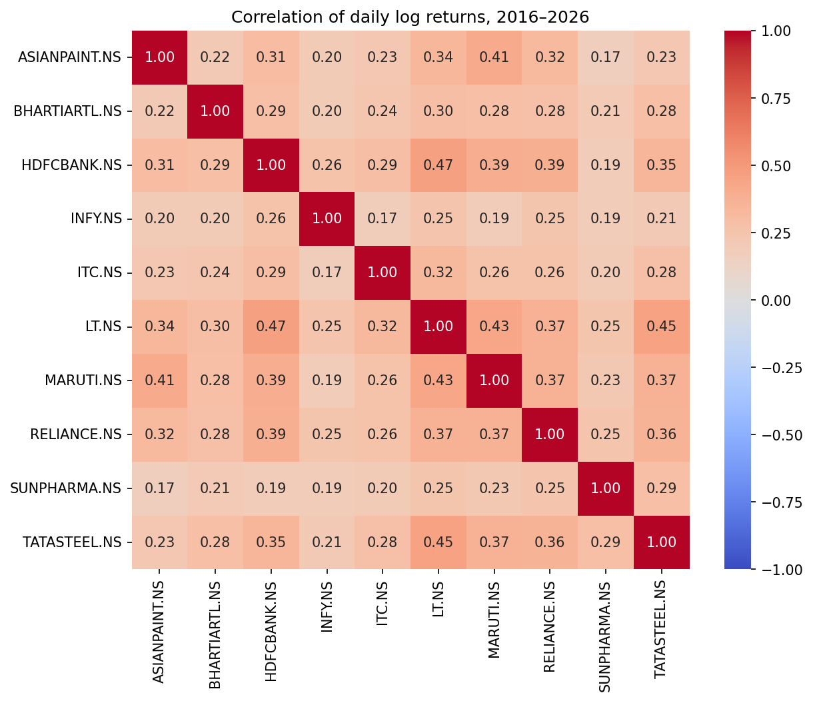
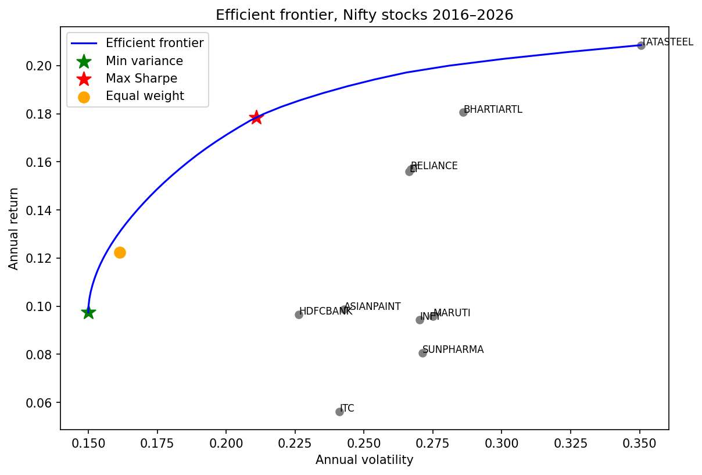
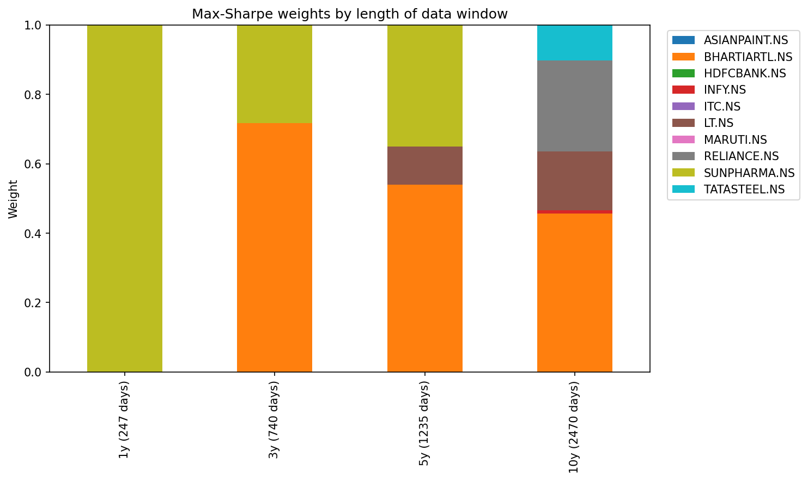
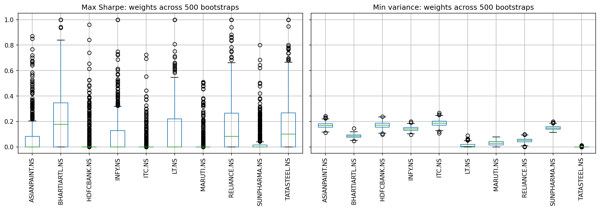
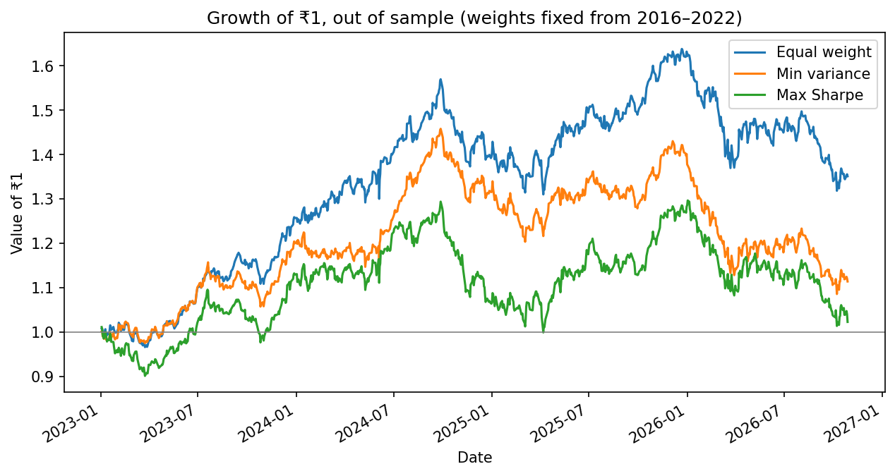

# How Much Can You Trust an "Optimal" Portfolio?

Mean-variance (Markowitz) optimization on ten Nifty 50 stocks, testing how stable the "optimal" weights are and whether they hold up out of sample.

**Author:** Ayon Majumdar · **Started:** October 2026 · **Tools:** Python, pandas, NumPy, SciPy, Matplotlib, seaborn, yfinance

## Question

Modern Portfolio Theory gives an "optimal" portfolio from historical returns and covariances. But those inputs are estimates from a finite sample. How sensitive are the weights to the data, and does optimization actually beat a simple equal-weight portfolio on data it has not seen?

## Data

- 10 Nifty 50 stocks across sectors: RELIANCE, HDFCBANK, INFY, ITC, SUNPHARMA, LT, MARUTI, TATASTEEL, BHARTIARTL, ASIANPAINT
- Daily adjusted closing prices from Yahoo Finance (`yfinance`), 1 Jan 2016 – 28 Oct 2026 (2,673 trading days, no missing values)
- Risk-free rate: 5.9337%, 91-day T-bill CCIL indicative yield, 29 Oct 2026

## Method

1. **Returns and risk:** daily log returns; annualised mean (×252) and covariance matrix (×252).
2. **Optimization:** long-only, fully invested (weights ≥ 0, sum to 1), solved with `scipy.optimize.minimize`. Minimum-variance and maximum-Sharpe portfolios, plus the efficient frontier.
3. **Window sensitivity:** re-optimized max-Sharpe using the last 1, 3, 5 and 10 years of data.
4. **Bootstrap:** resampled daily returns with replacement 500 times (seed 42) and re-optimized each sample.
5. **Out-of-sample test:** weights estimated on 2016–2022, held fixed and evaluated on Jan 2023 – Oct 2026 against an equal-weight (1/N) benchmark.

## Results

**Returns are fat-tailed.** Excess kurtosis ranges from 3.4 (Tata Steel) to 10.8 (ITC); a normal distribution gives 0. Reliance's largest daily move was about 8 standard deviations.

**The max-Sharpe portfolio is concentrated.** On the full sample it held only four stocks: Bharti Airtel 36%, Tata Steel 25%, Reliance 23%, L&T 16%, the four with the highest past returns.

**The weights depend heavily on the data window.**

| Window | Sun Pharma | Bharti Airtel | Stocks used |
|---|---|---|---|
| 1 year | 100% | 0% | 1 |
| 3 years | 28% | 72% | 2 |
| 5 years | 35% | 54% | 3 |
| 10 years | 0% | 46% | 4 |

**Bootstrap: max-Sharpe is unstable, min-variance is stable.** In max-Sharpe, every stock's 5th-percentile weight is 0%; Tata Steel ranges from 0% to 63%. In min-variance, most weights stay within a few percentage points (e.g. ITC 15–23%). Min-variance depends only on the covariance matrix, which is estimated far more precisely than mean returns.

**Out of sample, equal weight won.** (Jan 2023 – Oct 2026)

| Strategy | CAGR | Volatility | Sharpe | Max drawdown |
|---|---|---|---|---|
| Equal weight | 8.4% | 12.5% | 0.20 | −19.5% |
| Min variance | 2.9% | 12.0% | −0.25 | −25.6% |
| Max Sharpe | 0.6% | 14.6% | −0.37 | −22.8% |

The 2016–2022 max-Sharpe portfolio put 86% into the five worst performers of 2023–2026 and 0% into the top three (Bharti Airtel +27.6%, L&T +18.6%, Sun Pharma +17.4% a year). Rankings largely reversed between the two periods.

## What I learned

_[Write this yourself, 3–4 sentences.]_

## Limitations

- Mean-variance assumes risk is captured by variance, but returns are fat-tailed.
- Daily rebalancing to fixed weights, with no transaction costs or taxes.
- One train/test split and one four-year test period, so the out-of-sample result is evidence, not proof.
- Ten hand-picked stocks that are all in the Nifty 50 today (survivorship bias).

## Next steps

- Shrinkage estimators for the covariance matrix and mean returns
- Rolling (walk-forward) rebalancing across many test periods
- Black-Litterman and robust optimization

## Reference

DeMiguel, V., Garlappi, L. and Uppal, R. (2009). Optimal Versus Naive Diversification: How Inefficient Is the 1/N Portfolio Strategy? *Review of Financial Studies*, 22(5), 1915–1953.

## How to run

Open `portfolio_stability.ipynb` in Google Colab and run all cells. Requirements: `yfinance pandas numpy scipy matplotlib seaborn`.
